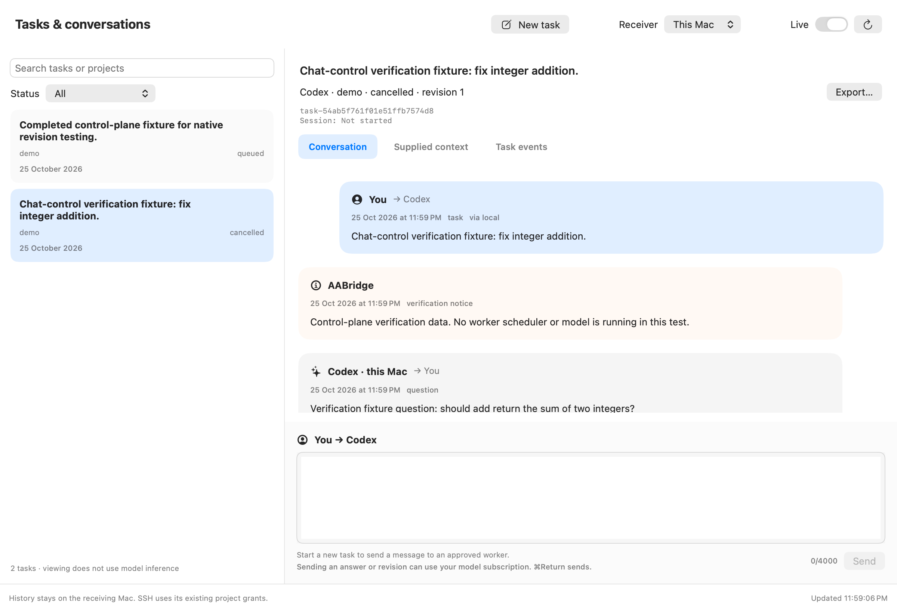

# Task chat and agent labels

Version `0.2.0.dev5` adds editable file scope, immediate pending bubbles and worker
activity to the native task chat. See [scope setup](scopes-and-progress.md).

## Install and use

Use `dist/AABridge-Scope-2026-10-26.zip` on both Macs. Quit older AABridge windows
before opening the newly extracted app.

On the **mini**, open **Receiver setup → Install receiver**. Wait for **Receiver
ready**. This updates and restarts an idle receiver, preserving paths, projects,
task history, provider login and SSH pairing. Older receivers reject the new
author metadata and the app displays an update instruction. Keep Remote Login
enabled and the selected SSD attached.

On the **MacBook**, open **Tasks & conversations**, select **mini**, then:

1. Choose **New task**, select an approved project/worker and enter instructions.
   **Start task** sends it and opens its saved conversation.
2. When the worker asks a question, type below the conversation and choose
   **Send answer** or Command–Return.
3. After completion, enter a follow-up and choose **Request revision**, within
   that task's revision/turn limits.
4. **Cancel task** targets only the selected queued/running/waiting task and
   preserves partial work.

Starting, answering or revising a task can start subscription model inference.
Browsing and refreshing do not. These are managed project task conversations;
general free-form assistant chats and arbitrary shell/build execution remain
unsupported. File-proposal projects prepare scoped changes for human review;
the separate math demo retains fixed tests. No task can change its project
scope, executable, source baseline, permissions or SSH policy.

## Who sent each message

Chat bubbles show sender, recipient, timestamp and message kind:

- Desktop submissions and replies are labelled **You → Codex**.
- Worker replies identify the registered worker and receiving machine, such as
  **Codex · mini → You**.
- Named agent coordinators use their recorded agent label. Agent callers can
  include `origin: {"kind": "agent", "name": "Codex coordinator"}` in submit,
  answer and revision bodies, using exactly the same body on retries.
- Older messages without author metadata retain a generic **Coordinator
  (macbook)** label instead of inventing an agent or human identity.
- Verification, failure and cancellation messages are attributed to AABridge.

The journal stores display provenance and both task owner and requesting
coordinator identity. A local operator can answer a peer-owned task without
rewriting its ownership. Names/kinds supplied by a coordinator are display
metadata; they do not prove a human approval or grant authority. Authentication,
ownership, project grants, revocation, question IDs and revisions still govern
every operation. The desktop backend labels its own sends as human. Historical
journal rows are not relabelled when a later message has a different author.

Worker proposals display readable file contents; independently verified results
remain separate messages with expandable commit/verification details. Context,
events and exports remain available alongside the chat.

## Quiet refresh and drafts

**Live** still polls every five seconds while the task view is selected. It
updates in the background without list/conversation spinners, keeps the existing
messages visible and preserves drafts. The unchanged last message does not
trigger an automatic scroll on each poll. Initial conversation loading and
explicit send actions can show progress. Errors remain visible.

Drafts that have not been sent remain in memory for the open app. A send is
first saved to a private local outbox with a stable request key. If acknowledgement
is lost, the exact operation/body/key survives app restart. **Retry same send**
reuses it, allowing the receiver's idempotency cache to return the original
acknowledgement without creating another task. The pending text is restored too.

The outbox is `~/Library/Application Support/AABridgeDesktop/pending-action.json`
in a private directory; it contains task text/request metadata, not provider
credentials or SSH keys. It is removed after successful acknowledgement.
**Clear pending send** only clears this local recovery record and allows editing
or a new intent. It never undoes an already accepted operation or cancels a task.
When unsure, inspect the task list first. Retries are explicit, not automatic.

## Claude

Projects whose worker is Claude Code are listed as `project · Claude` and use
the same start, answer, revise and cancel controls as Codex. Choose the worker
and store the `claude setup-token` token in **Projects & scope** on the
receiving Mac. See the [Claude Code worker guide](claude-worker.md). Disabled
projects, and agents without an adapter (Gemini), cannot be started from the
GUI. An active Claude coordinator's MCP integration is a separate route and is
not a connection to an arbitrary existing desktop chat.

## Verification

The unit/service suite tests provenance through human and agent follow-ups,
unchanged historical labels, actual local-operator identity versus task owner,
malformed origins, access denial despite a claimed human name, and desktop
action request keys/author metadata.

`scripts/verify_chat.py` drives the compiled native model through its real bundled
backend and authenticated IPC: answer, revision, cancel and submit. It deliberately
commits a submit and drops its acknowledgement, restores the private outbox in a
fresh native model, and retries the same request. The server retains exactly one
new task. It also checks silent-refresh flags and draft preservation, and renders
the app's own view for inspection. This is an explicit control-plane fixture:
no worker scheduler, agent process or model inference runs. All fixture execution
gates are disabled and queued requests cancelled at teardown. Interactive desktop
automation is still unavailable without Computer Use permissions. The updated
physical mini needs local installation before live GUI task testing there.

Release checks and bundle hashes are recorded in
[release evidence](evidence/chat-release-2026-10-25.json).
