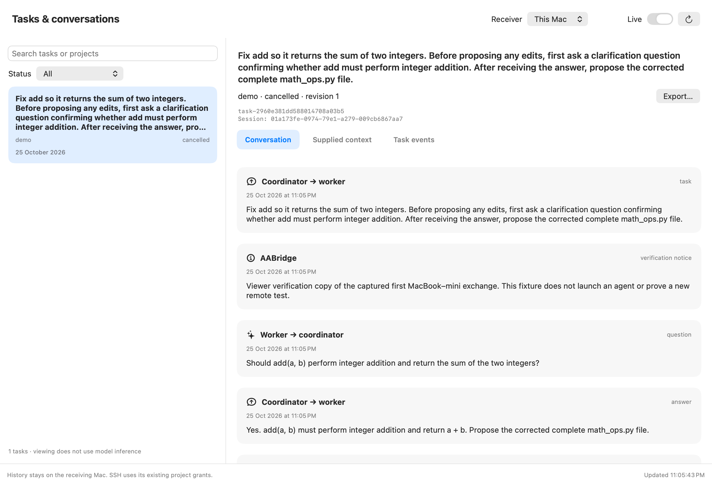

# Conversations, task context, and local storage

Version `0.2.0.dev3` added permanent bridge history. The current `0.2.0.dev5`
also adds [task chat controls and agent labels](chat-ui.md).



This is the app's own offscreen verification render using a labelled copy of the
captured first test exchange, not a new physical mini model run.

## Read tasks on either Mac

Current builds include shared Task history for coding projects. Update the app
and installed receiver on both Macs. In Task history, select the Mac where the
task ran. Its local coding tasks appear read-only when that Mac has granted
your paired connection access to the project. Tasks submitted through this
connection retain their normal controls. Another peer's tasks and local proposal
tasks are not included in shared reads. See the shared-history section of
[team collaboration](team-collaboration.md).

If the receiver is older, the viewer shows its existing owned tasks with a
notice to update it. A normal network refresh does not upgrade the receiver.
Local source history is read live; there is no background database copying.
The older setup instructions below remain relevant to legacy SSH deployments.

Use the current `dist/AABridge-Claude-2026-10-26.zip` on both Macs.
Quit an older AABridge window before opening the newly extracted app.

On the **mini**, choose **Receiver setup → Install receiver** once. This upgrades
the private bridge environment and restarts an idle supervisor. Existing selected
paths, project approvals, task history, provider login, and restricted SSH pairing
are preserved. It refuses to replace a receiver with an active or closing task.
Wait for **Receiver ready**. Keep Remote Login on and the selected SSD attached.

On the **MacBook**, open the app and choose **Tasks & conversations**. Select
**mini** from the receiver menu. No receiver installation or Remote Login is
needed on the MacBook just to browse an already enrolled mini. The desktop app
uses its bundled Python bridge and your existing private pairing configuration.
Python 3.11+ must be available; the development MacBook already has it.

Select a task to read:

- **Conversation:** task instructions, worker questions/proposals, coordinator
  answers/revisions, independently verified results, and failure/cancellation notices.
- **Supplied context:** approved baseline/scope/acceptance/context and each
  prepared model input, including scoped source contents and worker instructions.
  Prepared input is recorded before the worker call; a failed startup does not
  prove that the model received it.
- **Task events:** ordered lifecycle events and timestamps.

Search and status filters operate on the authorized task list. **Live** refreshes
every five seconds while this view is selected, without recurring loading
spinners. **Export** writes a Markdown
copy of the loaded messages and context to a location you choose. Viewing,
refreshing, and exporting do not start inference or consume Codex model usage.
Starting a task or answering/revising one through the existing CLI/MCP can.
The current app also offers New task, question answers, bounded revisions and
cancellation through its chat composer. See [task chat](chat-ui.md).

An older receiver that lacks history operations displays an update instruction.
It does not silently show an empty successful history. Missing access, revoked
pairing, unreachable hosts and a stopped supervisor produce visible errors.

## Persistence guarantees

On the receiving Mac, `~/Library/Application Support/AABridge/bridge.sqlite3`
contains schema version 2:

- `tasks`: current state, which changes as work progresses.
- `messages`: an ordered append-only message journal. Rows are not overwritten
  when a question is answered or a result is revised. SQLite triggers reject
  accidental UPDATE/DELETE operations on this table.
- `events`: lifecycle metadata.
- `requests`: idempotency responses that prevent retrying a mutation from
  duplicating its effects or messages.

Task transitions and their message entries commit in one transaction before
acknowledgment. A history write failure rolls back the task mutation too. The
supervisor records prepared source/context and accepted result proposals before
verification. Verified result metadata is a separate journal entry. Accepted
application messages are retained; raw provider streams, internal reasoning,
provider credentials and SSH private keys are not added to this journal.
Manually supplied task/context text may itself contain sensitive information.

Large context entries are split into numbered parts. Cursor pagination preserves
their order and complete text while bounding each RPC response. The CLI and MCP
use the same access checks as the GUI: default peer reads see owned tasks in
assigned projects; explicit shared reads also permit the receiver-local coding
history described above. Revocation blocks both forms of history. The GUI adds no SSH shell access.

The database remains in the private existing state directory. It is not encrypted
by AABridge or automatically copied to a cloud backup. Append-only here protects
normal application behavior; the local account owner can still administer its
database. No automatic history pruning is implemented.

## Older tasks

The first schema-2 open migrates schema-1 records in a transaction. Existing task
state and request/event records remain intact. Retained objectives, current
questions, pending answers/revisions, context metadata and available results are
recovered into labelled entries. A notice explains that historical messages may
be missing and original order cannot be fully recovered. Migration does not
invent missing text or pretend reconstructed entries were recorded live.

The captured first physical test is also available as a separate readable export:
[mini-conversation-2026-10-25.md](evidence/mini-conversation-2026-10-25.md).
Installing this update cannot retroactively recreate messages the old bridge did
not keep. Older receiver binaries reject schema 2; keep using the updated build.

## What Codex stores, and what reaches OpenAI

These are separate records:

| Location | Contents |
| --- | --- |
| Bridge database on the receiving Mac | Application messages, task metadata, supplied context snapshots, events and result references |
| `AABridge/workspaces/TASK_ID/` | A local Git clone/checkout of the approved project baseline and that task's changes |
| `AABridge/workers/TASK_ID/codex-home/` | Dedicated Codex configuration and provider session files/databases; its auth entry references the existing local login |
| OpenAI model service | Receives requests necessary for inference; server handling follows the applicable account/workspace policies |

The model is supplied only the scoped source strings and task context, despite
the bridge maintaining a full approved repository checkout for independent Git
validation. The worker sandbox cannot read that repository directly. It is not
given this coordinator chat's entire history, your normal Codex chats, or all
files on the Mac. Its dedicated session preserves the worker's own conversation;
this does not imply unlimited model context or prevent provider compaction.

Official documentation describes [local Codex transcript persistence under
CODEX_HOME](https://learn.chatgpt.com/docs/config-file/config-advanced#history-persistence)
and the [subscription authentication/data-policy distinction](https://learn.chatgpt.com/docs/auth).
An earlier real local bridge demo was inspected by filename: its dedicated
Codex home contains session JSONL files and local provider databases. The mini's
exact provider files have not been inspected through its restricted bridge key.

Using a subscription establishes provider-side processing and usage accounting.
It does not, by itself, establish a permanent server archive available in your
normal ChatGPT chat list. Exact retention and export behavior for this individual
account has not been verified. AABridge does not rely on such an archive for its
own conversation history. Training controls and server-side retention are also
different questions; this project does not change your account settings.

## Command-line and MCP access

```sh
.venv/bin/aabridge task list --remote mini --cursor 0 --shared
.venv/bin/aabridge task conversation --remote mini --id TASK_ID --cursor 0 --shared
```

For a conversation, continue from the returned cursor while `has_more` is true.
Omit `--shared` to retain owned-only reads. MCP's `bridge_tasks`, `bridge_status`,
`bridge_conversation`, `bridge_events`, and `bridge_activity` accept the same
optional `shared: true` body field. This grants no task mutation authority.
For a task list, cursors page backwards from newest to oldest. MCP exposes
`bridge_tasks` and `bridge_conversation` with the same read-only semantics.

## Verification

The regression suite checks transactional rollback, duplicate retries, history
after question/answer/revision/reopen, migration notices, peer isolation,
revocation, append-only triggers, Unicode context pagination and real IPC
retrieval. The real localhost SSH smoke also reads tasks/conversations.
The native viewer is verified through its bundled wheel/helper and real local
IPC against an explicitly labelled fixture copied from the captured physical
test messages; no new model is launched. Its own view is rendered for visual
inspection. Interactive desktop automation remains unavailable because Computer
Use access is not enabled. The updated physical mini still needs local upgrade
before a new end-to-end model result test can run.

## Titles and the task menu

Task titles are short display labels, distinct from the complete objective. A
team leader supplies the label in its existing planning turn; task submission
carries optional `title` metadata, and old records receive a compact fallback.
The task card/header shows at most two lines and a separate stage label.

Use the ellipsis menu (or right-click a task) for **Edit title**, **Delete from
history**, and **Info**. Rename and removal are personal history preferences on
the selected receiver, associated with this connection's authenticated identity.
They persist across refresh/restart but do not rename the other Mac's own view.
Deleting removes the task from your visible list. It preserves saved records,
active work, Git results and team references; it does not erase a conversation.
Shared task work controls remain read-only even when these personal controls are
available. A current project grant is required for either operation.

Task IDs, session/thread identifiers, raw context, verification records and task
events are available under **Info**. Full instructions remain available there
and in the saved conversation. Diagnostic exports retain their complete data.
