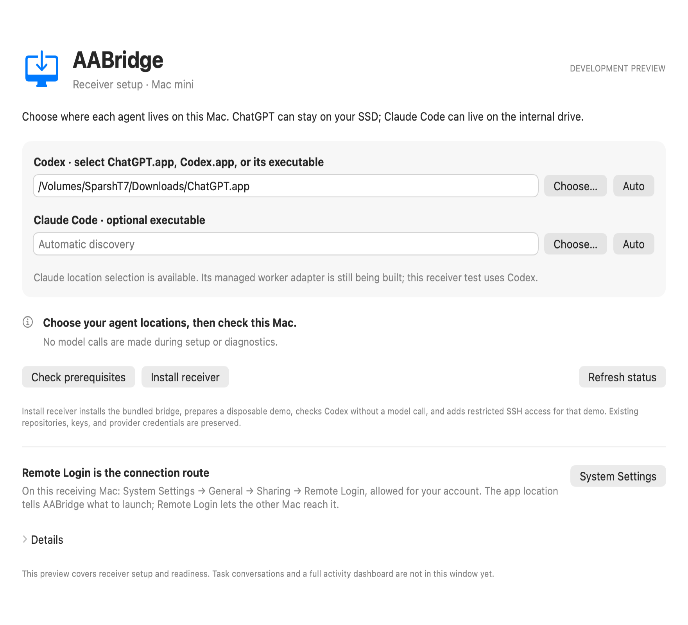

# Native AABridge app and receiver setup

The development preview is a native SwiftUI/AppKit app in `apps/desktop`, built
with a task/conversation viewer and the existing Python installer. It needs macOS 13 or later and includes
both Apple Silicon and Intel executable images. No Node server, browser, or
third-party Python GUI package is needed.

New device connections use AABridge's own encrypted TLS listener. After setting
up this Mac, exchange cards in **Devices**, then choose projects. Remote Login
is not required for new cards. See [direct connection setup](two-device.md).
The older demo/SSH installer remains available for existing deployments.



For browsing on the MacBook, read [tasks, conversations and storage](conversation-history.md).
The instructions below configure the receiving mini.

## On the Mac mini

1. Quit any older AABridge setup window. AirDrop
   `dist/AABridge-Claude-2026-10-26.zip` to the mini and unzip it.
2. Open `AABridge.app` inside the extracted folder and select **Receiver setup**.
3. For Codex, choose `/Volumes/SparshT7/Downloads/ChatGPT.app`. Finder may hide
   the `.app` extension. For Claude Code, optionally choose its executable;
   **Auto** also checks the normal local CLI installation locations. The two
   choices are independent. In a picker, Command–Shift–G lets you enter a path.
4. Select **Check prerequisites**. Expand **Details** for agent discovery and
   the six isolation canaries. This does not install the bridge, grant access,
   authenticate an agent, or start model inference. Missing Python is reported.
5. Select **Install receiver**. This uses the existing installer: private Python
   environment, disposable demo, Codex account/isolation checks, restricted demo
   SSH grant, and background supervisor. It may prepare Python 3.11 through an
   existing Homebrew installation. A failed preflight blocks new SSH grants.
6. When the window says **Receiver ready on this Mac**, return to the MacBook
   chat for the real two-device test. **Refresh status** checks the local
   supervisor; it does not prove remote connectivity or model execution.

If a check fails, expand **Details**, use **Copy details**, and share the final
diagnostic. No provider transcript or credential is requested. A missing login
can still require Codex's local login flow; the GUI does not collect credentials.

Remote Login must remain enabled on the receiving mini for the current SSH
transport. It is separate from choosing an application path. Keep the selected
SSD connected. Choosing a missing path produces an error instead of falling
back to a different installation. App preferences are stored locally; selected
paths are passed as JSON in a private temporary payload copy, never shell code.
The signed application resources are not edited. The underlying bridge state
and private installation retain their existing Application Support locations.

The app's **Tasks & conversations** view shows labelled chat messages, tasks,
proposals/results, supplied context and lifecycle events. Its [chat controls](chat-ui.md)
start approved tasks, answer questions, request revisions and cancel selected work.
Use **Projects & scope** on the receiving Mac to register a repository and edit
its allowed files. See [scope setup and visible activity](scopes-and-progress.md).
Claude location discovery works independently;
its managed worker adapter and the Gemini adapter are not implemented yet.
Closing the setup window does not stop an installed supervisor. Avoid quitting
during installation; rerunning setup safely checks the existing state.

Version `0.2.0.dev2` fixes provider connection cleanup that could keep an answered
task queued on newer Python versions. When upgrading, **Install receiver** first
requires the existing receiver to be idle, then stops that owned supervisor
through local IPC before installing and starting the updated one. It preserves
selected paths, existing task history and SSH pairing. If a task is still active
or closing, the app asks you to wait and retry rather than orphaning its worker.

## Isolation error

The mini's reported log proves its SSD Codex executable was found. Its generic
isolation failure does not identify the failing canary or Python startup error.
The revised probe grants its own Python installation read access so interpreters
outside Apple Silicon Homebrew can load their libraries. This grant applies only
to the disposable canary process, never to the provider worker. All six exact
boolean results and an unchanged external canary are required to pass. No check
is skipped and a failure keeps execution disabled.

Reports now include failed check names, Python version/prefix, probe exit code,
and a bounded startup error category. Raw subprocess stderr is not exposed.
This addresses a portability defect; the physical mini must rerun the check to
determine whether it resolves that machine's failure.

## Build

With the Python development environment installed as described in the README
and Apple's command-line build tools available, run from the repository root:

```sh
make build
```

This runs the deterministic tests, builds the current Python wheel, creates a
fresh pairing payload, then compiles and verifies the universal Apple Silicon
and Intel app. Each run creates a new `dist/AABridge-build-XXXXXX/` directory
containing `AABridge.app`, `AABridge.zip`, and `SetupPayload.zip`. Previous app
builds are preserved. The command does not install or launch the app.

The payload uses the existing local device public key at
`~/Library/Application Support/AABridge/device-key.pub`. On a Mac without that
key, or when packaging for another coordinator, supply an existing dedicated
Ed25519 public key explicitly. No private key is bundled or generated:

```sh
make build PUBLIC_KEY="/absolute/path/to/dedicated-key.pub" PEER=macbook
```

`PYTHON` defaults to `.venv/bin/python` and can also be overridden. `make check`
runs only the deterministic tests. Runtime locations can be selected in the
app's receiver setup.

For manual builds or payloads with preselected runtime locations, use the
individual scripts below.

Build the wheel and a pairing payload with `scripts/make_pairing_bundle.py`,
then run:

```sh
.venv/bin/python scripts/build_desktop.py \
  --payload-zip /absolute/path/to/pairing-payload.zip \
  --output /absolute/path/to/new-desktop-preview.zip
```

The builder validates payload checksums, compiles both architectures with the
Apple command-line toolchain, combines them, applies a development ad-hoc
signature, verifies it, and checks required resources. This is a development
build, not a notarized public distribution. No model call is part of the build.
`AABridge.app/Contents/MacOS/AABridge --verify-gui /absolute/preview.png` renders
the app's own view and exercises its real diagnostic process/streaming path,
using an isolated preferences domain without installing or granting SSH access.
