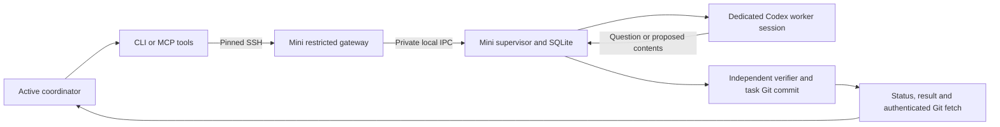

# AABridge: what is implemented and why

Status as of 26 October 2026 · version `0.2.0.dev6`

## Current outcome

AABridge now has a working communication and task-management foundation, with a
real local Codex worker demonstration and an implemented SSH transport. Its
execution profiles handle a tested arithmetic demo and locally approved text-file
proposals requiring human review. A managed Claude Code worker is implemented ([guide](claude-worker.md)); its live subscription test is pending. General shell/build execution, a managed Gemini worker, and a
successful physical MacBook–Mac mini delegation remain unfinished.

The real local demonstration completed this sequence: submit a task, receive a
worker question, save it and stop inference, answer it, resume the exact same
Codex session, receive an independently checked Git commit, request a revision,
and receive the revised commit. The active coordinator used bridge CLI commands;
no person forwarded the worker's messages.

The mini completed receiver setup through the native app. The MacBook can now
contact its protected bridge and received a real Codex clarification question
from it. Answer delivery worked, but turn resumption exposed a proxy cleanup
ordering bug. The test was cancelled and its worker finished closing. Version
`0.2.0.dev5` includes that fix, safe idle receiver upgrades, permanent message
history and native task chats with sender labels and task controls. The mini needs the current update
before a fresh full result/revision test.

## What you are running

AABridge is a Python terminal application with a background supervisor. Commands
such as `aabridge task submit` contact that supervisor. An active coding agent
can use the same operations through MCP tools. The supervisor owns task state,
worker processes and disposable task repositories.

The native app in `apps/desktop` provides receiver setup, independent Codex and
Claude file pickers, prerequisite diagnostics, live installation progress, and
local supervisor status. Its task browser adds search/status filters, permanent
message history, supplied context, lifecycle events and Markdown export for
authorized local or SSH tasks. Chat controls start approved tasks, answer worker
questions, request revisions and cancel active tasks. Five-second refreshes are
silent and preserve drafts. Pending sends survive app restart with their original
retry key. Viewing does not run model inference. See [chat controls](chat-ui.md).
Its local **Projects & scope** editor registers a committed repository, approved
existing/new file paths and enrolled sender access. Task scope can be narrowed
in the sender's New task form. Immediate pending bubbles show delivery state;
coarse worker activity shows connecting, session work, retry and proposal checks.
See [scope setup and progress](scopes-and-progress.md).
The `Setup.command`
Terminal launcher remains available as an alternative. See [desktop setup](desktop.md).

Each receiving machine needs its own bridge installation, approved project and
usable coding-agent runtime. A task's host and agent are separate choices: the
protocol is designed to support another runtime through another adapter.

## Repository separation

Your requested monorepo distinction is implemented. Runnable applications live
under `apps/`; reusable libraries live under `packages/`. Root files describe
workspace-wide packaging and configuration.

```text
AABridge/
  apps/
    cli/                  Terminal commands
    desktop/              Native macOS receiver setup window
    daemon/               Background task/worker supervisor
    mcp-server/           Tools for active coordinators
    installer/            Mac worker setup scripts
  packages/
    preflight/            Prerequisite diagnostics
    protocol/             Request validation and v1 schemas
    core/                 Policy, authentication and SQLite storage
    workspace/            Git clones, proposed edits and verification
    transport-local/      Private local communication
    transport-ssh/        Remote SSH communication
    adapter-codex/        Codex sessions and execution restrictions
  tests/                  Automated checks
  scripts/                Build, verification and pairing-bundle helpers
  examples/               Configuration examples
  docs/                   Design, setup, limitations and evidence
```

The runtime components ship as one Python package. The standalone installer is
delivered alongside that package in the pairing ZIP. Component folders provide
clear responsibilities without requiring a separate deployed service or release
for every directory.

## Stack decisions

| Choice | What it does | Why it was chosen |
| --- | --- | --- |
| Python 3.11+ | Runs the CLI, supervisor, transports, installer and adapter | Matches your preference and supplies the needed standard-library functionality. AABridge currently has no third-party runtime dependencies or Node requirement. Each host still needs a compatible Python installation. |
| SQLite | Stores tasks, events and mutation acknowledgements in a local database file | Provides transactions and restart persistence without installing or administering a database server. Each host owns its own database. PostgreSQL/MySQL would add server setup for the current workload; there is no requirement for a shared central database. |
| OpenSSH | Encrypts/authenticates communication between machines | Reuses established host keys, client keys and restricted-command support. It solves the secure transport problem; the bridge separately handles task durability, sessions and permissions. |
| Unix sockets | Carry requests between local clients and the supervisor | Keep local task operations off a public network port, with private directory/socket permissions and a separate authentication token. |
| Git | Copies an approved baseline and returns identifiable commits/diffs | Makes changes reviewable and preserves the active source checkout. GitHub is optional. |
| MCP over stdio | Gives active coding agents structured bridge tools | Separates the coordinator's agent product from task operations. It uses the same validated requests as the CLI. |

Python 3.11.17 was installed through Homebrew on the development MacBook, with a
project `.venv`. Apple's Python was preserved. A marked `~/.zprofile` block
selects the separate Homebrew Python for new login shells. This does not upgrade
Python on the mini automatically; its setup checks its own runtime.

## Implemented components and their purpose

| Component | Implemented behavior | Why it exists |
| --- | --- | --- |
| Operator CLI | Initialization, diagnostics, project registration/gates, peer grants/revocation, remote enrollment, service control and task commands | Makes setup and recovery explicit without requiring source-code edits. Policy-changing actions stay local. |
| Prerequisite diagnostics | Fixed version/help checks, Python/SQLite checks and state metadata inspection | Separates missing prerequisites from live execution. `doctor` does not log in or prove a project is ready to run. |
| Versioned protocol | Bounded request/task/event/result contracts and packaged v1 JSON schemas; strict field/type/path validation | Gives transports and agents one predictable contract. Peer text cannot supply executable paths, arbitrary local folders or shell authority. |
| Durable task engine | Transactions, task/attempt IDs, statuses, revisions, question IDs, event cursors and stored acknowledgements | Preserves work across reconnects and makes stale/cross-task messages rejectable. |
| Retry handling | Same mutation key/content returns the original acknowledgement; changed content fails | Prevents a lost connection or repeated tool call from creating a second task or applying a different operation under the same identity. |
| Supervisor | One active worker, runtime/turn/revision bounds, cancellation and conservative restart handling | Keeps worker lifetime independent of client connections and avoids starting replacements for uncertain surviving work. |
| Local transport | Private authenticated Unix socket, checked file ownership/modes and bounded replies | Provides controlled local access. A task ID alone is never a credential. |
| SSH transport/gateway | Verified pinned host key, dedicated identity, fixed RPC, restricted SSH key entry, project grants and revocation | Limits what a remote peer can request. The bridge key grants bridge/Git-result access rather than an interactive shell. |
| MCP facade | Projects, submit, status, events, answer, revise and cancel tools, with body schemas | Lets an active coordinator handle the question/result loop. It exposes no enrollment, execution-enable or generic command tool. |
| Codex adapter | Programmatic app-server start/resume, recorded exact thread/session IDs, structured outputs and safe provider-error handling | Controls dedicated managed sessions without scraping terminals or taking over an existing desktop chat. |
| Question checkpoints | Persist the question, close the worker process, then resume the saved thread after an authorized answer | Avoids keeping model inference running while waiting for clarification. |
| Workspace/result handling | Independent Git clone, exact baseline, scoped contents, checked proposed edits, task commits and diff inspection | Produces reviewable results while preserving the original repository. |
| Verification profile | Bounded interpretation of a small integer-function syntax tree | Checks the demo independently without running model-provided Python, imports or repository scripts. |
| Mac installer/pairing bundle | Offline wheel installation, disposable demo, Codex preflight and restricted public-key enrollment | Reduces the mini's manual setup. Existing authorized-key lines are preserved; conflicting/revoked grants are not silently replaced. |
| Build and verification helpers | Pinned build tools, wheel/source builds, offline installed-wheel smoke checks and real localhost SSH checks | Tests the distributed artifact and transport as well as imports from the development checkout. |

The installer ZIP contains the wheel, setup scripts, coordinator public key,
manifest and instructions. It contains neither the coordinator's private key
nor provider credentials. Checksums detect corrupted bundle contents; trusted
transfer and local review establish where the installer came from.

## How a remote task is intended to flow



The SSH client sends bounded operations to the mini. The mini's supervisor
starts the worker and saves its progress locally. Closing SSH or MCP does not
cancel the task. A question is retrieved through status; its answer must name
the current question and revision. A completed result identifies exact commits
that can be fetched into a separate review repository on the coordinator host.

Source baselines must currently be transferred/registered on the receiving host
by the operator. Automatic source publication from the coordinator is unfinished.
Provider authentication and model requests happen on the worker host; Codex
still needs connectivity to its provider. SSH is the between-computer channel,
not a replacement for the model provider.

Same-computer operation uses private local IPC instead of SSH. MCP provides
tools to an active coordinator; it cannot awaken an arbitrary idle desktop chat.

## Does a macOS sharing setting have to remain on?

**For the current MacBook → Mac mini SSH setup, Remote Login must be enabled on
the mini while you want remote bridge connections.** Apple's Remote Login
setting enables SSH access. Use the intended account under “Only these users.”
[Apple's Remote Login guide](https://support.apple.com/guide/mac-help/allow-a-remote-computer-to-access-your-mac-mchlp1066/mac)

| Setting or condition | Required by this implementation? |
| --- | --- |
| Remote Login on the receiving mini | Yes, for SSH task communication and result fetches. |
| Remote Login on the sending MacBook | Not for outbound-only use. Needed if it also receives SSH delegation from the mini. |
| Screen Sharing | No. Worker control does not use the screen. |
| Remote Management | No. Apple Remote Desktop is not used. |
| File Sharing | No. Result transfer uses authenticated Git over SSH. |
| “Allow full disk access for remote users” | Not required for the current private demo setup. Additional protected locations would need separate consideration. |
| Both machines reachable; receiving machine awake | Yes, for new remote communication. SSH does not provide automatic NAT traversal or routing. |

Remote Login can be turned off when remote access is not wanted. That makes new
SSH connections unavailable; it is not a bridge task-cancellation operation.
Use the bridge's cancel/stop commands for owned work. Local-only AABridge use
does not need Remote Login. The current transport would require an architectural
change to avoid an incoming SSH service on the receiving machine.

## ChatGPT app versus a separate Codex app

Your clarification is correct: the ChatGPT desktop app can contain Codex. A
separate Codex-branded app is not an inherent AABridge requirement. Official
OpenAI documentation explicitly describes the Codex runtime bundled with the
ChatGPT desktop app and notes that it may differ from a standalone CLI version.
[Official OpenAI troubleshooting documentation](https://learn.chatgpt.com/docs/reference/troubleshooting)

The successful local bridge test already used this executable inside the
MacBook's ChatGPT application:

```text
/Applications/ChatGPT.app/Contents/Resources/codex-cli/CodexCLI.app/Contents/MacOS/codex
```

That is an observed path on this MacBook, not an assumed universal mini path.
The installer searches `ChatGPT.app` and legacy `Codex.app` under `/Applications`
and the current user's `Applications` folder, in addition to PATH. On 25 October
we reproduced a discovery bug locally: ChatGPT includes both a native executable
and a launcher named `codex`, which the original fallback treated as ambiguous
when no PATH alias existed. The updated installer selects the known native image
within that app; separate conflicting installations still need an explicit choice.
The mini's exact executable version and unattended authentication remain to be
checked there. The earlier message alone did not prove Codex was absent.

The user subsequently clarified that the mini's ChatGPT app is on an SSD.
Per-agent local selections now support an app/executable outside the automatic
search roots. Codex can point to the selected external app while Claude Code
uses its independent local CLI installation. Missing selected drives produce an
availability error without falling back to another Codex. Path discovery and
configuration are implemented for both agents, and both have managed worker
adapters. See [runtime locations](runtime-locations.md).

The current adapter expects existing ChatGPT account authentication available
through a private local `auth.json`, and checks the account inside the restricted
worker process. A working GUI session alone has not yet proved that particular
preflight on the mini. Installing another copy should not be the default next
step until the existing bundled runtime and login are checked. My earlier wording
that asked for a separate “Codex app” was imprecise.

## Restrictions and their rationale

The worker proposes complete replacement contents for approved text files,
including explicitly permitted new paths. The supervisor checks those contents, applies permitted edits
and creates the commit. Model shell, file-edit, browser, MCP and other tools are
disabled. No arbitrary repository build/test script is executed.

The demo's integer-function profile independently tests its `add` function.
The new file-proposal profile checks file boundaries and the resulting Git diff,
but does not test application behavior. Its result is explicitly review-required.
New files live in a separate task checkout, not the original project folder.
Broader automated execution requires an independently justified execution boundary.

The registered demo defaults to 180 seconds of accumulated attempt runtime,
four worker turns and one revision request, with one worker active at a time.
Tasks can request lower limits within local policy. Waiting for a question's
answer does not keep a worker process running.

Concrete protections include private state/tokens, project/task ownership,
host-key pinning, revocation, strict messages, scope checks, no-follow file opens,
hardlink/symlink checks, and macOS process restrictions. Disposable probes tested
denial of outside reads/writes/deletion, direct network access and child
execution, plus allowed writes within the worker runtime. A per-worker
authenticated relay restricts provider connectivity to `chatgpt.com:443`.

The macOS profile allows platform operations by default and adds explicit
denials. System IPC, the OS and the installed Codex harness remain trusted. The
harness must read its own credential. Same-user malicious processes and a
compromised harness/kernel are outside the proven boundary. These tests are not
a comprehensive hostile-code sandbox proof. Runtime/turn limits also do not
guarantee a currency spending cap. Full details are in [the threat model](threat-model.md).

## What has actually been tested

| Evidence | Result and practical meaning |
| --- | --- |
| Automated suite | 140 passing tests in the latest recorded run; includes new file creation, scope/peer configuration, review-required results, activity metadata, atomic history, retries, access controls, proxy shutdown and idle upgrades. |
| Real local Codex | Question → answer → same-thread resume → checked commit → revised commit passed with the user's existing ChatGPT account. |
| Real localhost OpenSSH | Pinned authentication, submission/replay, Git transfer, generic-command denial, actual host-key mismatch and revocation passed. Includes a state path containing spaces. Result fixture was constructed without a model. |
| MCP | Real stdio initialization/tool schemas and protected IPC tested. A live coordinator using the installed MCP configuration remains to be demonstrated. |
| Installer | Offline installation in a disposable HOME passed; expected missing-login failure prevented SSH enrollment. Existing-key preservation and unsafe-file checks passed. |
| Packaged distribution | Wheel/source build and offline installed-wheel import, CLI, initialization and MCP/schema checks passed. |
| Physical mini | Receiver ready, pinned authenticated bridge access and a real Codex question passed. Answer delivery passed; full result/revision awaits the receiver update and a fresh test. |

Internal deterministic worker fixtures test repeatable failures without consuming
model usage. They are not deployed fake agents and do not count as live model or
physical two-device evidence. The full execution record and original commits
are linked from [verification.md](verification.md).

## Changes made outside the source tree

On the MacBook, setup created a project virtual environment, the separate
Homebrew Python installation/shell preference described above, private bridge
state under `~/Library/Application Support/AABridge`, a dedicated SSH identity
there, and a pinned mini host-key file. Private credentials are not repository
files. Disposable test repositories/state were created for verification; the
local live-demo services were stopped afterward.

The mini installer is designed to create its environment/demo under
`~/Library/Application Support/AABridgeInstall`, create private bridge state,
then append the restricted public-key entry only after successful preflight.
The user's reported failure means those steps cannot all be claimed complete
on the mini. Its actual completed installation steps have not been inspected.

## Remaining work

1. Diagnose discovery and authentication of the Codex runtime already bundled in
   the mini's ChatGPT app, then complete restricted bridge enrollment.
2. Run the physical remote question/answer/result/revision task and fetch/review
   its exact commits on the MacBook.
3. Demonstrate the active coordinator workflow through installed MCP tools.
4. Run a bounded live Claude Code subscription task; implement and test a Gemini adapter.
5. Expand supported development/verification profiles with an enforceable
   execution boundary and appropriate tests.
6. Complete the required reverse-direction/provider demonstrations and fuller
   source-transfer workflow.

The bridge remains a development release. The full requirements are in
[specification.md](specification.md); the staged status is in
[milestones.md](milestones.md). This document records the current implementation
and its reasons without treating future work as delivered behavior.
