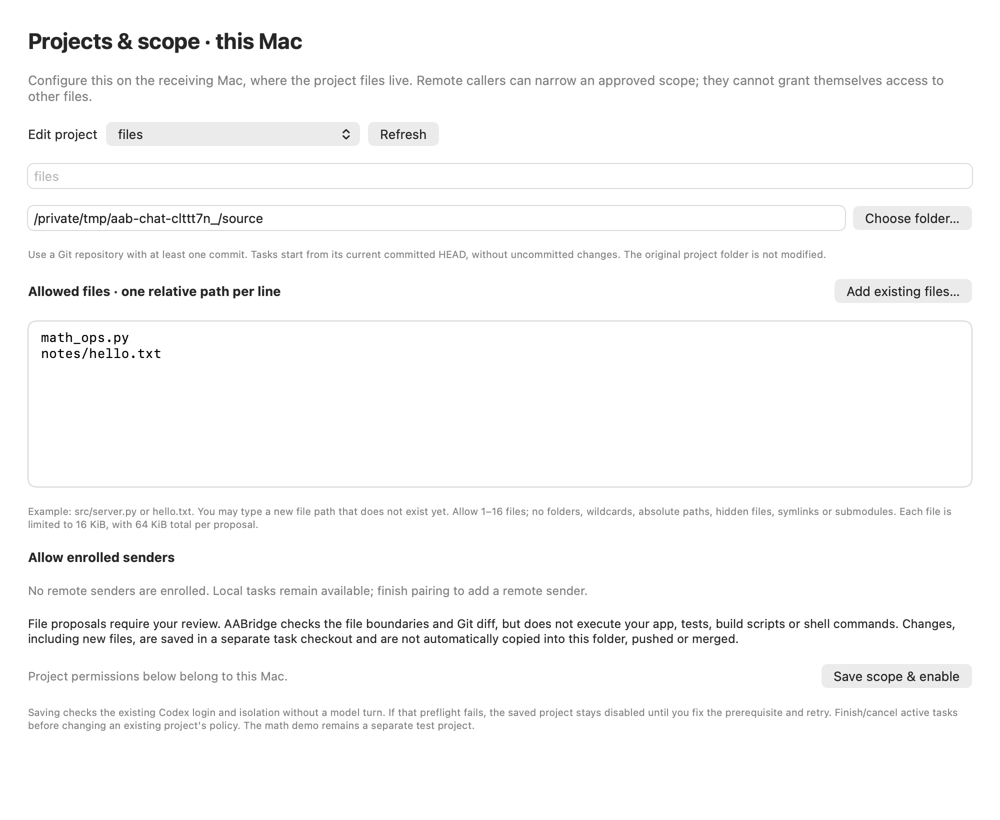
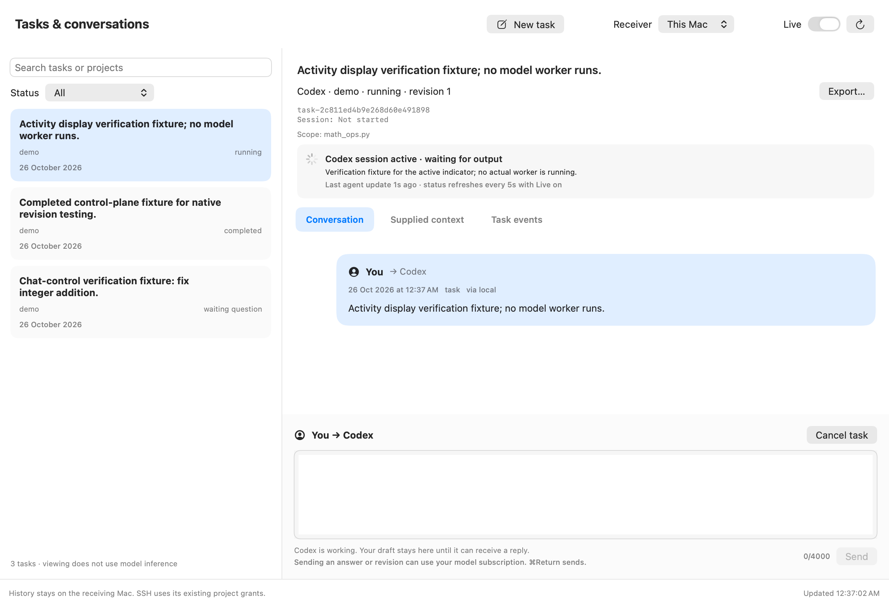
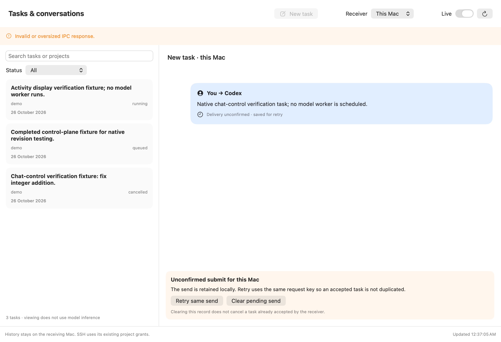

# Project scope, file proposals and visible activity

Version `0.2.0.dev5`, 26 October 2026.

## Why the math file appeared

The initial receiver installer created a disposable project named `demo`. Its
approved scope is `math_ops.py`, with an `add(a, b)` function checked against
fixed integer addition cases. It was a communication/resumption/verification
test, not a general repository configuration. The first chat GUI inherited that
demo approval without offering a project editor; this made the product too narrow.

The reported physical task asked to create a file under
`/Volumes/SparshT7/Sparshur/SparshurBackend`, but selected `demo`. Its saved worker
proposal contained no edits and explained that only `math_ops.py` was permitted.
The bridge then checked the unchanged demo function, which deliberately returns
subtraction, against addition cases. That produced `An integer-function acceptance
case failed.` No requested file or result commit was created by that task.
New demo errors include the function, arguments, actual value and expected value.
The chat now shows proposal issues as well as its summary.

## What scope means

A registered **project** maps an ID to a Git repository on the receiving Mac,
an approved committed baseline, worker runtime, file permissions and resource
limits. **Project scope** is an explicit allowlist of repository-relative paths
that its callers may submit. **Task scope** is a selection within that allowlist:
it determines which file contents are supplied to the worker and which paths its
proposal may change. Changing an instruction cannot expand either permission.

Existing files are supplied from the committed baseline. An approved new path is
supplied as `null`, meaning it does not yet exist. The worker may propose its full
contents, including an empty string for an empty file. Hidden paths, traversal,
absolute paths, folders, wildcards, symlinks and submodules are unsupported.

## Configure your backend example

1. Put `dist/AABridge-Scope-2026-10-26.zip` on both Macs, unzip it and quit older
   app copies. On the mini, open **Receiver setup → Install receiver**, keeping
   Remote Login on and the SSD connected. Existing scopes, history and enrolled
   keys are preserved; setup does not reset projects back to demo-only access.
2. On the **mini**, open **Projects & scope**. Choose **Create a new file-proposal
   project**, and enter an ID such as `backend`.
3. Use **Choose folder** to select
   `/Volumes/SparshT7/Sparshur/SparshurBackend`. It must be a Git repository with
   at least one commit. Tasks use committed HEAD, not uncommitted changes.
4. In **Allowed files**, enter `hello.txt` for a new file, or choose existing
   committed files with **Add existing files**. Use relative paths, one per line.
5. Select the enrolled sending peer, such as `macbook`, and choose **Save scope &
   enable**. This saves local policy and checks the existing Codex account and
   isolation without starting a model turn. If preflight fails, the project stays
   disabled with an error; fix the prerequisite and retry.
6. On the **MacBook**, select receiver **mini**, refresh, and choose **New task →
   backend**. Edit the **Task scope** field to select `hello.txt`, then ask:
   `Create an empty hello.txt file in this project's scope.` Start the task.

For later scope edits, select that project in **Projects & scope** on its receiver.
Finish or cancel active tasks first. Saving records current committed HEAD as the
new baseline and disables execution until the account/isolation check succeeds.
Use a new task after changing the baseline. The demo remains a separate project;
its fixed tests are not silently disabled or repurposed.

Policy editing is local to the receiving Mac. A remote sender can narrow its
task scope in the GUI, but cannot approve itself for additional files or projects.
Existing enrolled sender grants are updated only for the project you save.

## What a returned file proposal guarantees

`file-proposal-v1` supports approved text files across languages. It checks the
paths, size bounds, regular-file targets and resulting Git diff. It **does not
run the proposed code, application tests, builds or shell commands**, and does
not certify that the requested behavior is correct. Results are labelled
**Proposal ready · review required**, separately from the demo's tested result.

Files and commits are created in an isolated task checkout on the receiver.
Your original project folder is unchanged. Review the proposal in chat and the
result's commit/checkout details before copying or applying changes yourself.
There is no automatic push, merge, deployment or write into the original folder.
The CLI's existing result-fetch operation can retrieve an authorized result to
the sender; this release does not add a GUI apply/merge button.

Bounds remain 1–16 explicit files, 16 KiB UTF-8 per file, and 64 KiB source context
or proposed contents per turn. Existing scoped files must be committed. General
terminal access and arbitrary repository scripts are still unavailable. Claude
and Gemini managed worker adapters remain unimplemented.

## What you see while sending and working

Pressing Send or Start task immediately adds a local chat bubble containing your
text and **Sending… saved on this Mac**. It is pending until the receiver
acknowledges it. The durable pending record retains the original retry key.
After acknowledgement, the bubble stays visible while the saved conversation
loads, then is replaced by the journal entry. A lost acknowledgement is clearly
marked **Delivery unconfirmed**, with the existing same-request retry controls.
Unsent editor drafts remain drafts rather than pretending to be delivered.

An activity card distinguishes queued, running, waiting for your answer,
cancelling, failed and finished tasks. Updated receivers report preparing the
checkout, connecting, starting/resuming a session, waiting for output, worker
activity, provider retries and proposal checking. These are coarse execution
events, not model reasoning or a percentage estimate. The card shows the time
since the last agent update. A running status alone does not prove that tokens
are arriving continuously; an older receiver gets an explicit fallback message.

With **Live** on, saved status still refreshes every five seconds without flashing
list/conversation loaders or discarding drafts. Initial loads and explicit sends
can show progress. Turning Live off leaves the last observed state visible.

## Verification views

These are the app's own rendered views using explicitly labelled no-model IPC
fixtures. They are not screenshots of a new physical agent run.

See [release verification and hashes](evidence/scope-release-2026-10-26.json).
